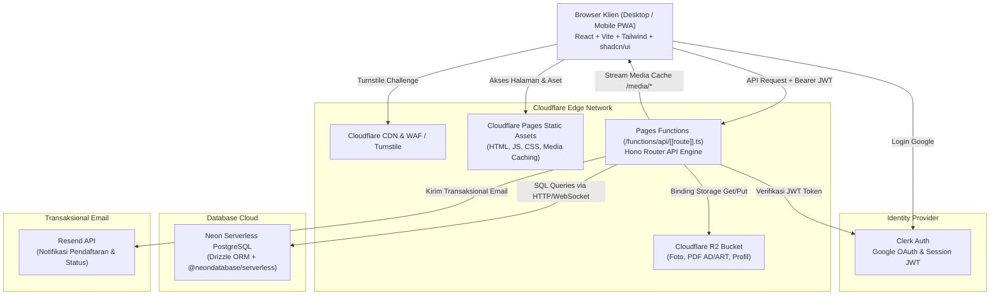
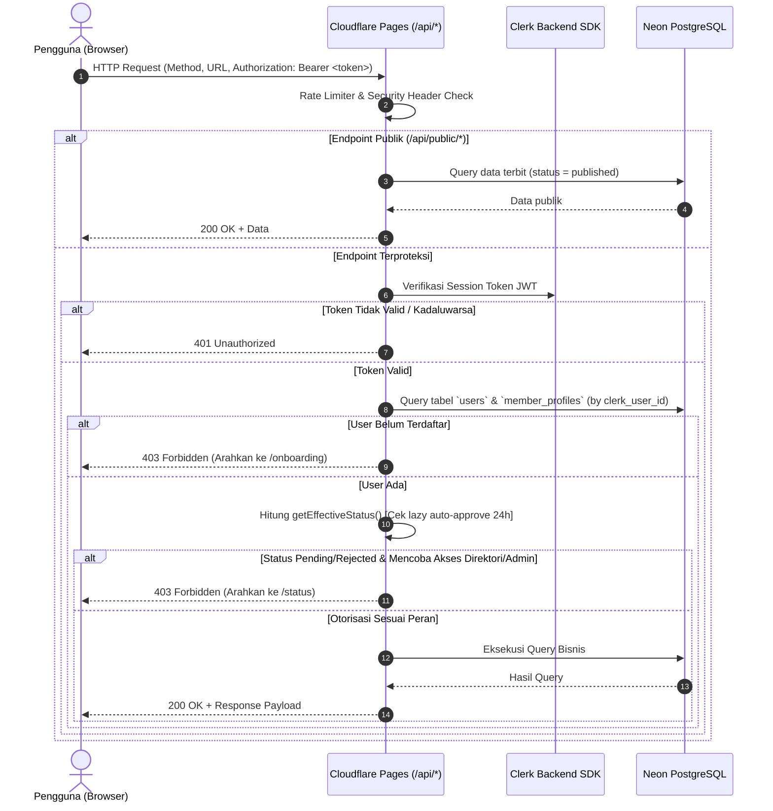

# Dokumen Arsitektur Sistem — KAPPAMA

Dokumen ini mendokumentasikan arsitektur teknis, topologi infrastruktur, alur request, keamanan otorisasi, dan catatan keputusan arsitektur (ADR) untuk website KAPPAMA.

---

## 1. Diagram Arsitektur Tingkat Tinggi



---

## 2. Struktur Direktori Proyek

```text
kappama/
├── .github/
│   └── workflows/
│       └── ci.yml               # Lint, typecheck, dan unit test otomatis
├── docs/                        # Aset dokumentasi pendukung
│   └── design-reference/        # Referensi visual desain (home-reference.png)
├── functions/                   # Cloudflare Pages Functions (Backend API)
│   ├── [[path]].ts              # Catch-all entrypoint Hono untuk Pages Functions
│   └── api/
│       ├── _middleware/         # Middleware auth Clerk, Turnstile, error handler
│       ├── public/              # Route API publik (organisasi, proker, galeri)
│       ├── me/                  # Route data profil & onboarding pengguna login
│       ├── members/             # Route direktori anggota (auth active member)
│       ├── lookups/             # Route master data wilayah, kampus, prodi
│       └── admin/               # Route khusus admin (konten, peran, persetujuan, ekspor)
├── src/                         # Frontend Application (React 18 + Vite)
│   ├── assets/                  # SVG, icon lokal, motif batik Pacitan
│   ├── components/              # Komponen UI
│   │   ├── ui/                  # Komponen shadcn/ui primitives
│   │   ├── layout/              # Navbar, Footer, AdminSidebar, PageHeader
│   │   ├── common/              # EmptyState, ErrorBoundary, LoadingSkeleton, TurnstileWidget
│   │   └── modules/             # Komponen modular per domain fitur (proker, galeri, direktori)
│   ├── hooks/                   # Custom react hooks (auth, query, media query)
│   ├── lib/                     # Utilitas klien (api-client, utils, formatter)
│   ├── pages/                   # Komponen halaman berdasarkan rute
│   │   ├── public/              # Beranda, Profil, Proker, Galeri, Kebijakan Privasi
│   │   ├── member/              # Onboarding, Status, Direktori, ProfilSaya
│   │   └── admin/               # Panel admin & dashboard
│   ├── routes/                  # Definisi router & route guard
│   ├── App.tsx                  # Root component (Provider wrapper)
│   └── main.tsx                 # Entry point klien
├── shared/                      # Kode & Skema Bersama Frontend + Backend
│   ├── schema/                  # Zod validation schema (auth, member, proker, etc.)
│   └── types/                   # TypeScript interfaces & enums
├── db/                          # Database & ORM
│   ├── schema.ts                # Drizzle ORM PostgreSQL schema
│   ├── migrations/              # Berkas migrasi Drizzle
│   └── seed/                    # Seed master data wilayah, kampus, & dummy dev
├── public/                      # Aset statis publik (favicon, robots.txt, _headers)
├── drizzle.config.ts            # Konfigurasi migrasi Drizzle
├── vite.config.ts               # Konfigurasi Vite
├── tailwind.config.ts           # Konfigurasi tema Tailwind (Navy & Gold Soga)
├── tsconfig.json
├── package.json
└── [Dokumen Bagian 14]         # PRD, tujuan.md, arsitektur.md, dll.
```

---

## 3. Alur Request & Otorisasi



---

## 4. Mekanisme Lazy Auto-Active 24 Jam

Karena Cloudflare Pages Functions tidak menyediakan cron job bawaan gratis, aturan PRD Bagian 7 diimplementasikan secara **lazy evaluation**:

1. Saat pengguna menyelesaikan onboarding:
   - `status = 'pending'`
   - `submitted_at = NOW()`
   - `approval_type = NULL`
2. Fungsi utilitas server tunggal `getEffectiveStatus(member)` dieksekusi di setiap pengecekan otorisasi:
   ```typescript
   export function getEffectiveStatus(member: {
     status: MemberStatus;
     submittedAt: Date | null;
   }): { status: MemberStatus; isAutoPromoted: boolean } {
     if (member.status === 'pending' && member.submittedAt) {
       const twentyFourHoursMs = 24 * 60 * 60 * 1000;
       const isPast24Hours = (Date.now() - new Date(member.submittedAt).getTime()) >= twentyFourHoursMs;
       if (isPast24Hours) {
         return { status: 'active', isAutoPromoted: true };
       }
     }
     return { status: member.status, isAutoPromoted: false };
   }
   ```
3. Jika `isAutoPromoted === true`, server secara asynchronous atau inline melakukan update status di database:
   - `status = 'active'`
   - `approved_at = submitted_at + interval '24 hours'`
   - `approval_type = 'auto'`
   - Mencatat event transisi otomatis ke `audit_logs`.

---

## 5. Alur Pengunggahan File ke Cloudflare R2

1. Pengguna (Admin Konten / Anggota untuk foto profil) mengunggah file gambar/PDF.
2. Di sisi klien:
   - Gambar dikompresi di browser menggunakan Canvas/WebWorker ke format WebP (dimensi maksimal 1600px atau 1920px untuk sampul, target ukuran ≤ 400KB).
3. Request multipart/form-data dikirim ke endpoint Pages Functions `/api/admin/uploads` atau `/api/me/avatar`.
4. Server memverifikasi otorisasi, MIME type sebenarnya (magic number check), dan batas ukuran.
5. File disimpan ke Cloudflare R2 dengan key berformat UUID acak:
   - `media/programs/{uuid}.webp`
   - `media/albums/{uuid}.webp`
   - `media/avatars/{uuid}.webp`
   - `docs/bylaws/{uuid}.pdf`
6. File disajikan ke publik melalui route Pages Function `/media/*` dengan header HTTP Cache:
   - `Cache-Control: public, max-age=31536000, immutable`

---

## 6. Estimasi Pemakaian Kuota Gratis (Free Tier)

| Layanan | Batas Gratis Resmi | Estimasi Pemakaian KAPPAMA (v1) | Status Keamanan Kuota |
|---|---|---|---|
| **Cloudflare Pages** | Build 500/bln, Unlimited bandwidth | ~50 build/bln, ~10 GB bandwidth | Sangat Aman |
| **Pages Functions** | 100.000 requests / hari | Rata-rata < 1.000 requests / hari | Sangat Aman |
| **Cloudflare R2** | 10 GB penyimpanan, 10M reads/bln, 1M writes/bln | ~500 MB (foto terkompresi & PDF) | Sangat Aman |
| **Neon PostgreSQL** | 0.5 GiB storage, compute sharing | < 50 MB data teks untuk ±500 pengguna | Sangat Aman |
| **Clerk Auth** | 10.000 Monthly Active Users (MAU) | < 200 MAU per tahun | Sangat Aman |
| **Resend** | 100 email / hari, 3.000 email / bulan | < 20 email / hari | Sangat Aman |
| **Turnstile** | Bebas kuota wajar | < 500 tantangan / bulan | Sangat Aman |

---

## 7. Catatan Keputusan Arsitektur (ADR)

### ADR-001: Penggunaan Hono pada Cloudflare Pages Functions
- **Konteks:** Dibutuhkan router API backend yang efisien, ringan, type-safe, dan kompatibel penuh dengan Cloudflare Workers/Pages runtime.
- **Keputusan:** Menggunakan Hono (`hono/tiny` atau `hono`) di dalam `/functions/[[path]].ts`.
- **Alternatif Ditolak:** Express (tidak berjalan di edge worker), Remix/Next.js (terlalu berat untuk kebutuhan KAPPAMA dan vendor-lockin hosting).
- **Konsekuensi:** Routing API terpusat, middleware mudah di-chain, integrasi Zod validator bawaan sangat ringkas.

### ADR-002: Lazy Auto-Approval vs Cron Worker
- **Konteks:** Syarat pendaftar otomatis berstatus `active` setelah 24 jam tanpa cron berbayar.
- **Keputusan:** Menggunakan evaluasi lazy di fungsi `getEffectiveStatus()` pada middleware server dan query handler, lalu write-through persistence ke Neon.
- **Alternatif Ditolak:** Menambah Cloudflare Worker berbayar atau layanan cron pihak ketiga eksternal yang rawan kegagalan sinkronisasi kredensial.
- **Konsekuensi:** Biaya tetap Rp0, logika waktu teruji deterministik melalui unit test tanpa ketergantungan trigger background.

### ADR-003: Drizzle ORM dengan @neondatabase/serverless
- **Konteks:** Database Neon memerlukan koneksi fleksibel yang dapat berjalan pada lingkungan serverless/edge tanpa koneksi pool stateful yang menggantung.
- **Keputusan:** Menggunakan Drizzle ORM dipadukan dengan driver HTTP Neon (`neon()` dari `@neondatabase/serverless`).
- **Alternatif Ditolak:** Prisma (overhead binary engine besar pada Pages Functions), raw SQL tanpa type-safety.
- **Konsekuensi:** Startup cepat (cold start rendah), migrasi otomatis via CLI, schema type-safety di TypeScript.
