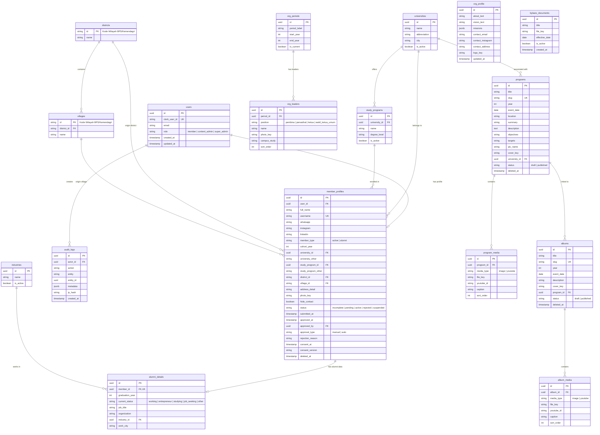

# Dokumen Skema Database — Website KAPPAMA

Dokumen ini mendefinisikan Entity Relationship Diagram (ERD), spesifikasi tabel, kolom, indeks, aturan relasi, dan strategi data wilayah Pacitan untuk PostgreSQL (Neon).

---

## 1. Entity Relationship Diagram (ERD)



---

## 2. Definisi Indeks Kinerja & Keamanan

Untuk menjamin kueri cepat pada skala pertumbuhan data dan pencegahan scanning lambat:
1. `member_profiles`:
   - `idx_member_profiles_status_type`: `(status, member_type)`
   - `idx_member_profiles_university`: `(university_id)`
   - `idx_member_profiles_cohort`: `(cohort_year)`
   - `idx_member_profiles_district`: `(district_id)`
   - `idx_member_profiles_username`: `(username)` UNIQUE
   - `idx_member_profiles_full_name_trgm`: Indeks trigram (`gin (full_name gin_trgm_ops)`) atau B-tree untuk kueri pencarian nama.
2. `programs`:
   - `idx_programs_status_year`: `(status, year)`
   - `idx_programs_slug`: `(slug)` UNIQUE
3. `albums`:
   - `idx_albums_status_year`: `(status, year)`
   - `idx_albums_slug`: `(slug)` UNIQUE
4. `audit_logs`:
   - `idx_audit_logs_actor_created`: `(actor_id, created_at DESC)`
   - `idx_audit_logs_entity`: `(entity, entity_id)`

---

## 3. Aturan Penyimpanan Media & Penghapusan Lunak (Soft Delete)

### 3.1 Aturan Kolom Kunci Media (*_key)
Seluruh kolom penyimpan referensi media (`photo_key`, `logo_key`, `file_key`, `cover_key`) **hanya menyimpan `public_id` Cloudinary** (misal: `kappama/programs/proker-1-cover`) atau path berkas statis lokal (misal: `/docs/ad-art-kappama.pdf` pada opsi cadangan PDF), **bukan URL absolut penuh**. URL CDN teroptimasi dibangun secara dinamis di klien dan server melalui antarmuka `StorageService`.

### 3.2 Aturan Penghapusan Lunak (Soft Delete)
Tabel berikut menerapkan soft delete dengan kolom `deleted_at timestamp with time zone`:
- `member_profiles`
- `programs`
- `albums`

Semua kueri aplikasi secara default menerapkan filter `WHERE deleted_at IS NULL`. Tindakan penghapusan permanen (*hard delete*) hanya diizinkan untuk peran **Super Admin** melalui konfirmasi khusus dengan pencatatan eksplisit di `audit_logs`.

---

## 4. Master Data Wilayah Pacitan (Sumber Resmi & Validasi)

Sesuai aturan PRD Bagian 9 & 14, daftar kecamatan dan desa/kelurahan diambil dari rujukan resmi kode wilayah administratif Kemendagri / BPS Jawa Timur (Kabupaten Pacitan: kode `35.01`).

- **Sumber Data:** Kepmendagri No. 100.1.1-6117 Tahun 2022 / Data Master Wilayah Kemendagri & BPS.
- **Tanggal Verifikasi:** 25 Oktober 2026.
- **Jumlah Wilayah:** 12 Kecamatan, 171 Desa/Kelurahan (166 Desa + 5 Kelurahan).

### 12 Kecamatan Resmi Kabupaten Pacitan:
1. `35.01.01` - Donorojo
2. `35.01.02` - Pringkuku
3. `35.01.03` - Punung
4. `35.01.04` - Pacitan (Termasuk Kelurahan Pacitan, Baleharjo, Ploso, Sidoharjo, Sumberharjo)
5. `35.01.05` - Kebonagung
6. `35.01.06` - Arjosari
7. `35.01.07` - Nawangan
8. `35.01.08` - Bandar
9. `35.01.09` - Tegalombo
10. `35.01.10` - Tulakan
11. `35.01.11` - Ngadirojo
12. `35.01.12` - Sudimoro

Data lengkap 171 desa/kelurahan akan di-seed melalui berkas `db/seed/pacitan-regions.json`.

---

## 5. Strategi Migrasi & Seed Drizzle ORM

1. Skema didefinisikan secara deklaratif di `db/schema.ts`.
2. Generator migrasi dijalankan melalui:
   ```bash
   pnpm db:generate
   ```
   menghasilkan berkas SQL di folder `db/migrations/`.
3. Migrasi diterapkan ke Neon via:
   ```bash
   pnpm db:migrate
   ```
4. Seed master data (`pnpm db:seed`) mengeksekusi urutan:
   - Master 12 Kecamatan dan 171 Desa Pacitan.
   - Master 13 Universitas di Malang + opsi "Lainnya".
   - Master Program Studi populer per universitas.
   - Master 10 Bidang Industri umum.
   - Periode kepengurusan saat ini (`org_periods`).
   - Placeholder profil organisasi (`org_profile`).
   - Akun bootstrap dummy untuk lingkungan pengujian dev.
