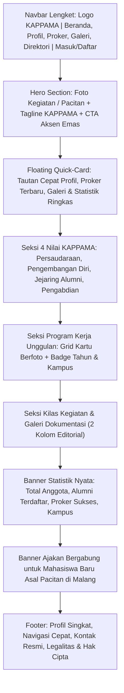

# Sistem Desain (Design System) — Website KAPPAMA

Dokumen ini adalah acuan visual, token gaya, panduan antarmuka, dan pemetaan tata letak referensi untuk memastikan tampilan website KAPPAMA konsisten, modern, mudah diakses, dan memiliki identitas budaya Pacitan yang kuat.

---

## 1. Karakter Visual & Filosofi
- **Elegan & Profesional:** Menggambarkan organisasi kemahasiswaan formal, terstruktur, dan kredibel.
- **Identitas Kedaerahan (Pacitan):** Nuansa ornamen pesisir dan motif batik khas Pacitan (seperti Batik Pace / Motif Jagad Pacitan) yang diterapkan secara halus (*subtle*) sebagai latar belakang tipis, pemisah seksi, atau aksen visual.
- **Ramah & Modern:** Pemanfaatan ruang putih (*whitespace*) yang lapang, radius sudut membulat lebar (*rounded-2xl*), dan bayangan bertingkat lembut (*soft shadows*).

---

## 2. Palet Warna (Color Tokens)

Kombinasi warna utama adalah **Biru Dongker (Deep Navy)** yang merepresentasikan kedalaman samudra selatan Pacitan dan kedewasaan intelektual, berpadu dengan **Kuning Soga / Emas Hangat (Amber/Gold)** sebagai aksen tradisional yang hangat.

| Token | Nama Nilai | Kode Hex / HSL | Penggunaan |
|---|---|---|---|
| `primary` | Pacitan Navy | `#0F1E36` / `218 56% 14%` | Latar navbar, heading utama hero, tombol primer |
| `primary-hover` | Navy Hover | `#162C4E` / `217 55% 20%` | Interaksi hover tombol primer |
| `secondary` | Ocean Blue | `#1E3A8A` / `224 64% 33%` | Elemen penunjang, kartu sekunder |
| `accent` | Soga Gold / Amber | `#D97706` / `38 92% 50%` | CTA aksi penting (Daftar), badge sorotan, rating |
| `accent-light` | Soga Soft Amber | `#FEF3C7` / `48 96% 89%` | Latar badge, highlight kartu pilihan |
| `background` | Warm Clean White | `#F8FAFC` / `210 40% 98%` | Latar belakang halaman umum |
| `surface` | Pure White | `#FFFFFF` / `0 0% 100%` | Kartu konten, modal dialog, formulir |
| `text-primary` | Slate 900 | `#0F172A` / `222 47% 11%` | Teks judul dan paragraf utama |
| `text-muted` | Slate 500 | `#64748B` / `215 16% 47%` | Keterangan tambahan, label sekunder |
| `border` | Slate 200 | `#E2E8F0` / `214 32% 91%` | Garis pembatas kartu dan input field |
| `success` | Emerald Green | `#10B981` / `160 84% 39%` | Status aktif, persetujuan disetujui |
| `warning` | Amber Warning | `#F59E0B` / `38 92% 50%` | Status pending menunggu persetujuan |
| `destructive` | Crimson Red | `#EF4444` / `0 84% 60%` | Penolakan pendaftar, penghapusan, suspend |

---

## 3. Tipografi

- **Font Utama (Body & UI):** `Plus Jakarta Sans`, sans-serif modern dengan legibilitas tinggi pada layar ponsel.
- **Font Aksen Judul (Heading):** `Plus Jakarta Sans` (SemiBold / Bold 700) dipadukan dengan sentuhan elegan pada tagline penting.
- **Skala Ukuran Tipografi:**
  - `Display / Hero Title`: 36px (Mobile) / 54px (Desktop) — Font Weight: 800, Line Height: 1.15
  - `H1 (Page Heading)`: 28px (Mobile) / 36px (Desktop) — Font Weight: 700
  - `H2 (Section Heading)`: 22px (Mobile) / 28px (Desktop) — Font Weight: 600
  - `H3 (Card Title)`: 18px / 20px — Font Weight: 600
  - `Body Regular`: 15px / 16px — Font Weight: 400, Line Height: 1.6
  - `Small / Caption`: 12px / 13px — Font Weight: 500

---

## 4. Spasi, Radius, & Efek Visual

- **Radius Sudut (Border Radius):**
  - Kartu & Kontainer Utama: `rounded-2xl` (16px) hingga `rounded-3xl` (24px) untuk nuansa modern ramah.
  - Tombol & Input Field: `rounded-xl` (12px).
  - Badge & Chips: `rounded-full` (9999px).
- **Bayangan (Box Shadows):**
  - `shadow-sm`: Pembatas halus kartu default (`0 1px 2px 0 rgb(0 0 0 / 0.05)`).
  - `shadow-card`: Kartu konten menonjol (`0 10px 25px -5px rgba(15, 30, 54, 0.06)`).
  - `shadow-floating`: Kartu aksi melayang di hero (`0 20px 35px -10px rgba(15, 30, 54, 0.12)`).
- **Pola Ornamen Budaya:**
  - Pola vektor SVG ornamen motif Pace Pacitan dengan opasitas sangat rendah (5% - 8%) pada section banner dan hero footer.

---

## 5. Pemetaan Referensi Desain (`docs/design-reference/home-reference.png`)

Berdasarkan referensi visual yang disediakan pada PRD Bagian 11.2, tata letak halaman Beranda KAPPAMA disusun dengan padanan fungsional:

---

## 6. Standar Status UI (UI States)

Semua komponen daftar dan tampilan data wajib mengimplementasikan 4 status visual:
1. **Loading State:** Skeleton loader (`<Skeleton />` dari shadcn/ui) dengan proporsi yang persis merefleksikan kartu sebenarnya. Tidak menggunakan spinner putar tengah layar yang monoton.
2. **Empty State:** Ilustrasi ramah, teks penjelas dalam Bahasa Indonesia, dan tombol tindakan (misal: *"Belum ada program kerja untuk tahun ini. Silakan pilih tahun lain."*).
3. **Error State:** Pesan kegagalan ramah pengguna dengan tombol *"Coba Lagi"* (retry) otomatis ke TanStack Query.
4. **Form Validation:** Validasi inline berwarna merah lembut (`text-destructive`) langsung di bawah input field dengan pesan kesalahan berbahasa Indonesia yang jelas.

---

## 7. Aksesibilitas (WCAG 2.1 AA)

- Seluruh rasio kontras warna teks terhadap latar belakang wajib memenuhi minimal **4.5:1** untuk teks normal dan **3:1** untuk teks tebal/besar.
- Setiap tombol ikon wajib memiliki `aria-label` terjemahan Indonesia (misal: `aria-label="Tutup menu navigasi"`).
- Fokus keyboard terlihat jelas menggunakan ring aksen emas (`focus-visible:ring-2 focus-visible:ring-accent`).
